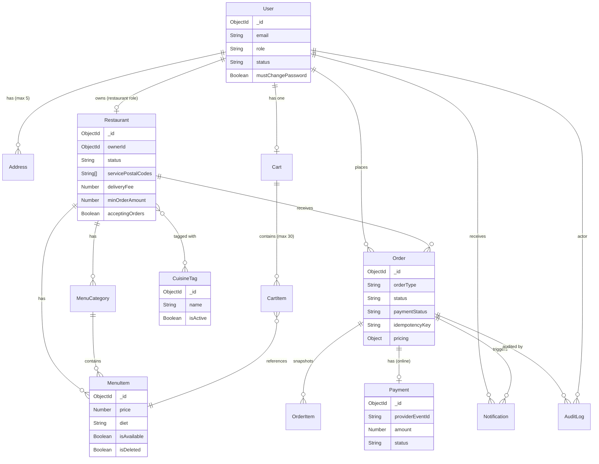

# 06 — Database Design

## 1. Collections

### Core Collections (v1)
`users`, `restaurants`, `menuCategories`, `menuItems`, `carts`, `addresses`, `orders`, `payments`, `notifications`, `auditLogs`, `cuisineTags`

### Out of Scope for V1 (`[D20]`)
`reviews`, `coupons`, `favorites`, `restaurantStaff`, `branches`

---

## 2. Schema Definitions

### 2.1 User
```js
{
  _id:              ObjectId,
  name:             String,          // required, 1-100 chars
  email:            String,          // required, unique, lowercase, trimmed
  phone:            String,          // required
  passwordHash:     String,          // Argon2 hash; never exposed via API
  role:             String,          // enum: ["customer", "restaurant", "admin"]
  status:           String,          // enum: ["ACTIVE", "SUSPENDED"]  [D2]
  mustChangePassword: Boolean,       // true for admin-provisioned restaurant owners [D2]
  createdAt:        Date,
  updatedAt:        Date
}
```
**Indexes**: `{ email: 1 }` — unique

---

### 2.2 Restaurant
```js
{
  _id:              ObjectId,
  ownerId:          ObjectId,        // ref: User (role: "restaurant"), 1-to-1 [D3]
  name:             String,          // required
  description:      String,
  logo:             String,          // relative asset path (local volume) [D20]
  banner:           String,          // relative asset path (local volume)
  cuisineCategories: [ObjectId],     // ref: CuisineTag — admin-managed list [ADM-003]
  contact: {
    phone:          String,
    email:          String
  },
  address: {
    addressLine1:   String,
    addressLine2:   String,
    city:           String,
    state:          String,
    postalCode:     String
  },
  servicePostalCodes: [String],      // delivery eligibility [D28]
  operatingHours: {
    monday:    { open: String, close: String, isOpen: Boolean },
    tuesday:   { open: String, close: String, isOpen: Boolean },
    wednesday: { open: String, close: String, isOpen: Boolean },
    thursday:  { open: String, close: String, isOpen: Boolean },
    friday:    { open: String, close: String, isOpen: Boolean },
    saturday:  { open: String, close: String, isOpen: Boolean },
    sunday:    { open: String, close: String, isOpen: Boolean }
  },                                 // evaluated in APP_TIMEZONE [D10] [D17] [D22]
  acceptingOrders:  Boolean,         // manual on/off toggle [D17]
  deliveryFee:      Number,          // integer, minor units [D4] [D9]
  minOrderAmount:   Number,          // integer, minor units [D4] [D9]
  status:           String,          // enum: ["ACTIVE", "SUSPENDED"] [D3]
  createdAt:        Date,
  updatedAt:        Date
}
```
**Indexes**: `{ status: 1 }`, `{ ownerId: 1 }` — unique (one restaurant per owner)

---

### 2.3 CuisineTag (admin-managed `[ADM-003]`)
```js
{
  _id:    ObjectId,
  name:   String,    // required, unique, trimmed
  isActive: Boolean
}
```

---

### 2.4 MenuCategory
```js
{
  _id:          ObjectId,
  restaurantId: ObjectId,   // ref: Restaurant
  name:         String,     // required
  description:  String,
  sortOrder:    Number,
  isActive:     Boolean,
  createdAt:    Date,
  updatedAt:    Date
}
```
**Indexes**: `{ restaurantId: 1, isActive: 1 }`

---

### 2.5 MenuItem
```js
{
  _id:             ObjectId,
  restaurantId:    ObjectId,   // ref: Restaurant
  categoryId:      ObjectId,   // ref: MenuCategory (same restaurant validated server-side)
  name:            String,     // required
  description:     String,
  price:           Number,     // integer, minor units [D4] [D7]
  image:           String,     // relative asset path (local volume) or null [D20]
  diet:            String,     // enum: ["veg", "non_veg"] [D7]
  isAvailable:     Boolean,
  preparationTime: Number,     // minutes, integer [D7]
  isDeleted:       Boolean,    // soft-delete [D26]; default false
  createdAt:       Date,
  updatedAt:       Date
}
```
**Indexes**: `{ restaurantId: 1 }`, `{ categoryId: 1 }`, `{ restaurantId: 1, isAvailable: 1, isDeleted: 1 }`

---

### 2.6 Cart
```js
{
  _id:          ObjectId,
  customerId:   ObjectId,   // ref: User (role: "customer")
  restaurantId: ObjectId,   // ref: Restaurant
  items: [{
    menuItemId: ObjectId,   // ref: MenuItem
    quantity:   Number      // integer, 1–20 [D6]
  }],
  updatedAt:    Date
}
```
Max 30 items per cart `[D6]`.

**Indexes**: `{ customerId: 1 }` — unique (one active cart per customer `[D6]`)

---

### 2.7 Address
```js
{
  _id:          ObjectId,
  customerId:   ObjectId,   // ref: User
  label:        String,     // e.g. "Home", "Work"
  name:         String,     // recipient name
  phone:        String,
  addressLine1: String,
  addressLine2: String,
  city:         String,
  state:        String,
  postalCode:   String,
  landmark:     String,
  createdAt:    Date,
  updatedAt:    Date
}
```
Max 5 per customer `[D22]`.

**Indexes**: `{ customerId: 1 }`

---

### 2.8 Order
```js
{
  _id:            ObjectId,
  customerId:     ObjectId,         // ref: User
  restaurantId:   ObjectId,         // ref: Restaurant (for inbox query)
  orderType:      String,           // enum: ["delivery", "pickup"] [D8]
  idempotencyKey: String,           // from Idempotency-Key header [D12]

  // Immutable snapshot at time of order creation [D5]
  restaurantSnapshot: {
    name:         String
  },
  items: [{
    menuItemId:   ObjectId,
    name:         String,           // snapshot
    unitPrice:    Number,           // integer, minor units [D4]
    quantity:     Number,           // integer 1-20
    lineTotal:    Number            // unitPrice * quantity, integer
  }],
  deliveryAddress: {                // null for pickup orders
    name:         String,
    phone:        String,
    addressLine1: String,
    addressLine2: String,
    city:         String,
    state:        String,
    postalCode:   String,
    landmark:     String
  },

  // All values are integers in minor units [D4] [D9]
  pricing: {
    subtotal:     Number,
    deliveryFee:  Number,
    taxPercent:   Number,           // snapshot of TAX_PERCENT env at order time
    tax:          Number,
    total:        Number
  },

  // Payment snapshot (never card data) [D23] [D25]
  paymentMethod:  String,           // enum: ["online", "cod", "pay_at_pickup"]
  paymentStatus:  String,           // enum: ["PENDING", "COMPLETED", "FAILED", "REFUND_PENDING", "REFUNDED"]
  paymentId:      ObjectId,         // ref: Payment (for online orders)

  status:         String,           // see state machine in docs/15
  statusHistory: [{
    status:       String,
    at:           Date,
    byRole:       String,           // enum: ["system", "customer", "restaurant", "admin"]
    reason:       String            // required for REJECTED, CANCELLED (by restaurant/admin)
  }],

  note:           String,           // optional, max 200 chars, plain text [D30]
  cancelReason:   String,           // set when status is CANCELLED or REJECTED

  createdAt:      Date,
  updatedAt:      Date
}
```
**Indexes**:
- `{ customerId: 1, createdAt: -1 }`
- `{ restaurantId: 1, status: 1, createdAt: -1 }`
- `{ customerId: 1, idempotencyKey: 1 }` — unique
- `{ status: 1, createdAt: 1 }` — for expiry job query (`PAYMENT_PENDING` older than 15 min)

---

### 2.9 Payment
```js
{
  _id:                ObjectId,
  orderId:            ObjectId,     // ref: Order
  customerId:         ObjectId,     // ref: User
  provider:           String,       // e.g. "razorpay" or "stripe"
  providerOrderId:    String,       // ID generated by provider for the order/session
  providerPaymentId:  String,       // ID of the completed payment (set on success)
  providerEventId:    String,       // unique webhook event ID for idempotency [D25]
  amount:             Number,       // integer, minor units (must match order.pricing.total) [D4] [D25]
  currency:           String,       // from env CURRENCY [D4]
  status:             String,       // enum: ["PENDING", "COMPLETED", "FAILED", "REFUND_PENDING", "REFUNDED"]
  refundId:           String,       // provider-issued refund ID after refund [D16]
  createdAt:          Date,
  updatedAt:          Date
}
```
**Indexes**:
- `{ providerOrderId: 1 }` — unique
- `{ providerEventId: 1 }` — unique (idempotency key for webhooks `[D25]`)
- `{ orderId: 1 }`

---

### 2.10 Notification
```js
{
  _id:           ObjectId,
  userId:        ObjectId,    // ref: User (customer or restaurant owner)
  type:          String,      // enum: ["ORDER_PLACED", "ORDER_CONFIRMED", "ORDER_REJECTED",
                              //        "ORDER_PREPARING", "ORDER_READY", "ORDER_OUT_FOR_DELIVERY",
                              //        "ORDER_DELIVERED", "ORDER_COMPLETED", "ORDER_CANCELLED",
                              //        "ORDER_EXPIRED", "PAYMENT_COMPLETED", "PAYMENT_FAILED",
                              //        "REFUND_INITIATED", "REFUND_COMPLETED"]
  title:         String,
  message:       String,
  referenceType: String,      // "order"
  referenceId:   ObjectId,    // orderId
  isRead:        Boolean,     // default: false
  createdAt:     Date
}
```
**Indexes**: `{ userId: 1, isRead: 1, createdAt: -1 }`

---

### 2.11 AuditLog (`[NFR-009]`)
```js
{
  _id:           ObjectId,
  actorId:       ObjectId,    // ref: User (who performed the action)
  actorRole:     String,      // enum: ["system", "customer", "restaurant", "admin"]
  action:        String,      // e.g. "ORDER_STATUS_CHANGED", "USER_SUSPENDED", "REFUND_TRIGGERED"
  targetType:    String,      // e.g. "order", "user", "restaurant"
  targetId:      ObjectId,
  metadata:      Object,      // non-PII contextual data (status transitions, reason)
  createdAt:     Date
}
```
**Indexes**: `{ actorId: 1, createdAt: -1 }`, `{ targetType: 1, targetId: 1, createdAt: -1 }`

> [!WARNING]
> `metadata` MUST NOT contain: passwords, tokens, card data, addresses, phone numbers, or any other PII. (`[NFR-009]`, `[D19]`)

---

## 3. Data Rules

1. All monetary values (`price`, `deliveryFee`, `minOrderAmount`, `subtotal`, `tax`, `total`, `amount`) are stored as **non-negative integers in minor currency units** (e.g., cents, paise). Floats are rejected by model validation. `[D4]`
2. Order item/pricing/address snapshots are **immutable** after creation. Historical totals are never recalculated from current menu prices. `[D5]`
3. Menu items are **soft-deleted** via `isDeleted: true`. Hard deletion is forbidden in v1. `[D26]`
4. `passwordHash` is **never returned** from any API endpoint.
5. Raw payment card data is **never stored or logged**. `[D23]`
6. Operating hours are stored in named-day format and evaluated in `APP_TIMEZONE`. `[D10]` `[D22]`
7. `Order.createdAt` schema field is explicitly configured to support order expiry testing and backdating while maintaining Mongoose timestamp generation.

---

## 4. Mermaid ER Diagram


