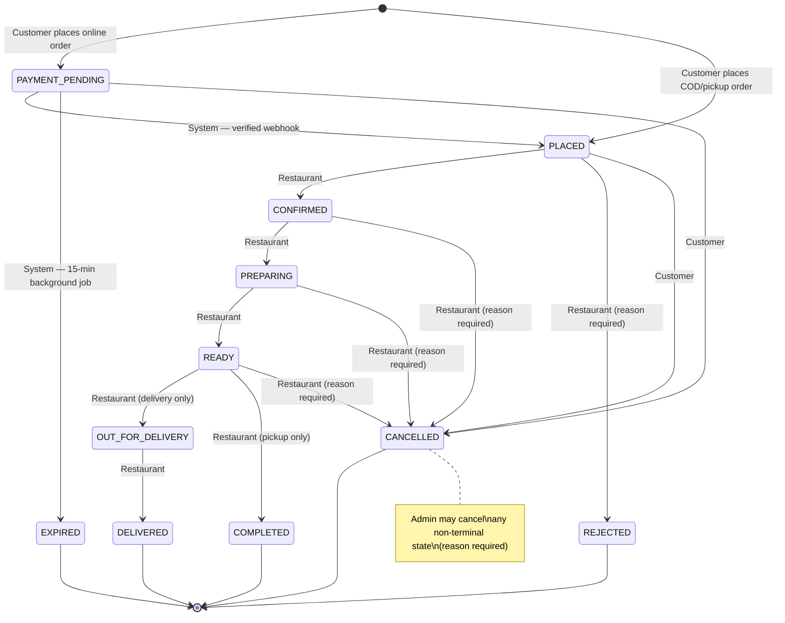

# 15 — Order Lifecycle

## 1. Resolved Order States `[D13]` `[D15]` `[D24]`

| State | Terminal? | Meaning |
|---|---|---|
| `PAYMENT_PENDING` | No | Online order created; awaiting payment webhook |
| `PLACED` | No | Order confirmed placed (COD/pickup) or payment verified |
| `CONFIRMED` | No | Restaurant has acknowledged the order |
| `PREPARING` | No | Restaurant is preparing the order |
| `READY` | No | Order is ready for pickup or handoff to delivery |
| `OUT_FOR_DELIVERY` | No | Order is with the delivery person (delivery orders only) |
| `REJECTED` | **Yes** | Restaurant rejected the order |
| `CANCELLED` | **Yes** | Order cancelled by customer, restaurant, or admin |
| `EXPIRED` | **Yes** | Online payment not received within 15 minutes |
| `DELIVERED` | **Yes** | Delivery order was delivered |
| `COMPLETED` | **Yes** | Pickup order was completed / handed to customer |

---

## 2. Allowed State Transitions `[D13]` `[D15]`

| From | To | Actor | Notes |
|---|---|---|---|
| `PAYMENT_PENDING` | `PLACED` | System | Verified payment webhook received `[D25]` |
| `PAYMENT_PENDING` | `EXPIRED` | System | 15-minute background job `[D24]` |
| `PAYMENT_PENDING` | `CANCELLED` | Customer | Customer cancels unpaid online order |
| `PLACED` | `CONFIRMED` | Restaurant | Restaurant acknowledges order |
| `PLACED` | `REJECTED` | Restaurant | Reason required; before preparation |
| `PLACED` | `CANCELLED` | Customer | Customer cancels after payment; reason optional |
| `CONFIRMED` | `PREPARING` | Restaurant | Preparation started |
| `CONFIRMED` | `CANCELLED` | Restaurant | Reason required |
| `PREPARING` | `READY` | Restaurant | Order is ready |
| `PREPARING` | `CANCELLED` | Restaurant | Reason required |
| `READY` | `OUT_FOR_DELIVERY` | Restaurant | Delivery orders only `[D8]` |
| `READY` | `COMPLETED` | Restaurant | Pickup orders only `[D8]` |
| `READY` | `CANCELLED` | Restaurant | Reason required |
| `OUT_FOR_DELIVERY` | `DELIVERED` | Restaurant | Marks delivery complete |
| *Any non-terminal* | `CANCELLED` | Admin | Reason required; any non-terminal order `[D13]` `[D21]` |

---

## 3. Cancellation & Rejection Rules `[D13]` `[D16]`

| Actor | Allowed When | Reason Required | Refund Trigger |
|---|---|---|---|
| Customer | `PAYMENT_PENDING` or `PLACED` | No | Yes, if `paymentStatus=COMPLETED` |
| Restaurant | Before `OUT_FOR_DELIVERY` or `COMPLETED`; cannot cancel terminal states | Yes | Yes, if `paymentStatus=COMPLETED` |
| Admin | Any non-terminal state | Yes | Yes, if `paymentStatus=COMPLETED` |

When refund is triggered: `paymentStatus → REFUND_PENDING`. Admin must then explicitly call `POST /api/admin/refunds` to process the gateway refund. `[D16]`

---

## 4. Status History

Every state transition appends an entry to `order.statusHistory`:

```json
{
  "status": "CONFIRMED",
  "at": "2024-01-15T10:30:00.000Z",
  "byRole": "restaurant",
  "reason": null
}
```

- `byRole`: `"system"` | `"customer"` | `"restaurant"` | `"admin"`
- `reason`: populated for `REJECTED`, `CANCELLED` (when required), `EXPIRED`

The `statusHistory` array is append-only and immutable. `[D5]`

---

## 5. State Machine Enforcement Rules

1. The server validates every requested transition against the allowed table above before persisting.
2. Invalid transitions return `409 INVALID_STATE_TRANSITION`.
3. Restaurant ownership is validated before any restaurant transition.
4. Customer ownership is validated before any customer transition.
5. Admin role is required for admin cancellations.
6. `orderType` is checked for `READY → OUT_FOR_DELIVERY` (delivery only) and `READY → COMPLETED` (pickup only).
7. All transitions write an `AuditLog` entry. `[NFR-009]`

---

## 6. Tracking `[D15]`

- Customer-facing order tracking displays the `statusHistory` timeline.
- The React frontend polls `GET /api/orders/:id` every **15 seconds** while:
  - The order status is non-terminal (not in `REJECTED`, `CANCELLED`, `EXPIRED`, `DELIVERED`, `COMPLETED`), AND
  - The browser tab has `document.visibilityState === "visible"`.
- Polling stops automatically when the order reaches a terminal state.
- No WebSockets, Server-Sent Events, or live GPS tracking in v1. `[D20]`

---

## 7. State Machine Mermaid Diagram


