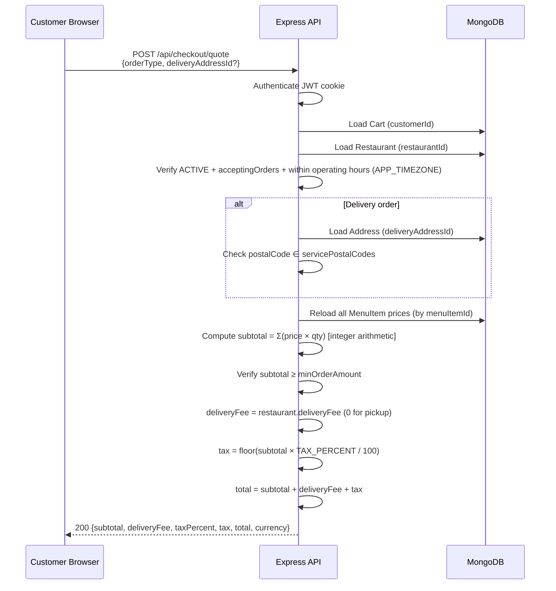
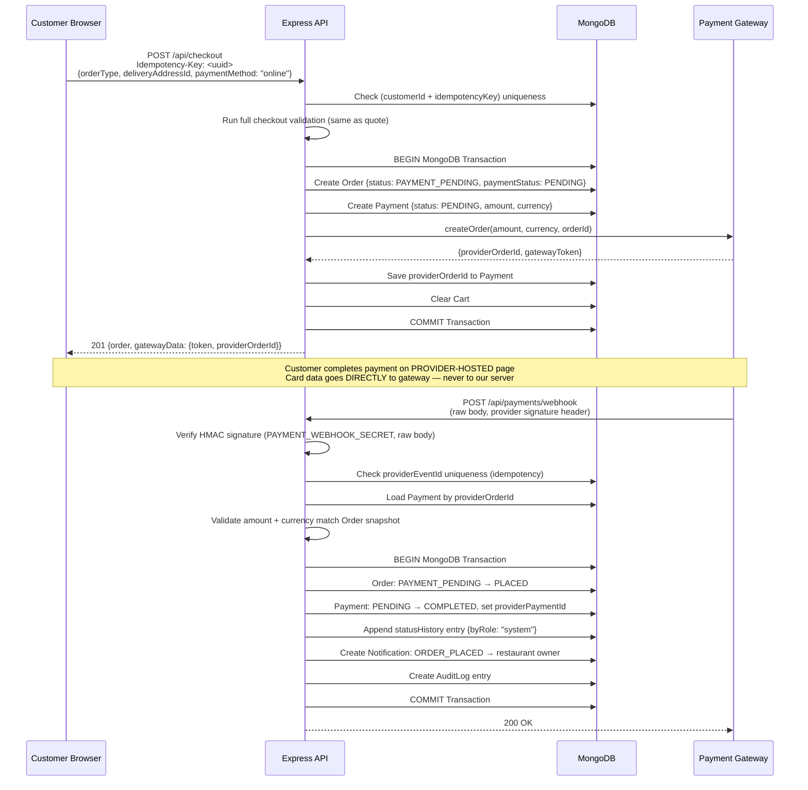
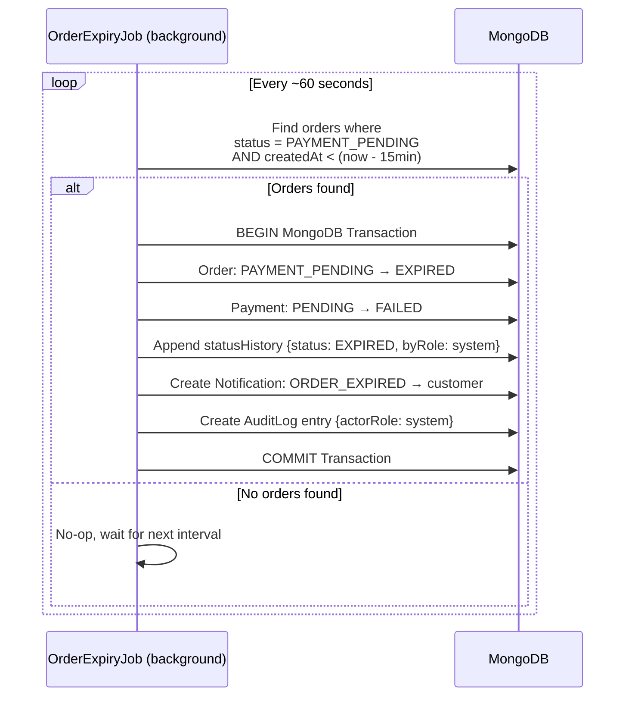
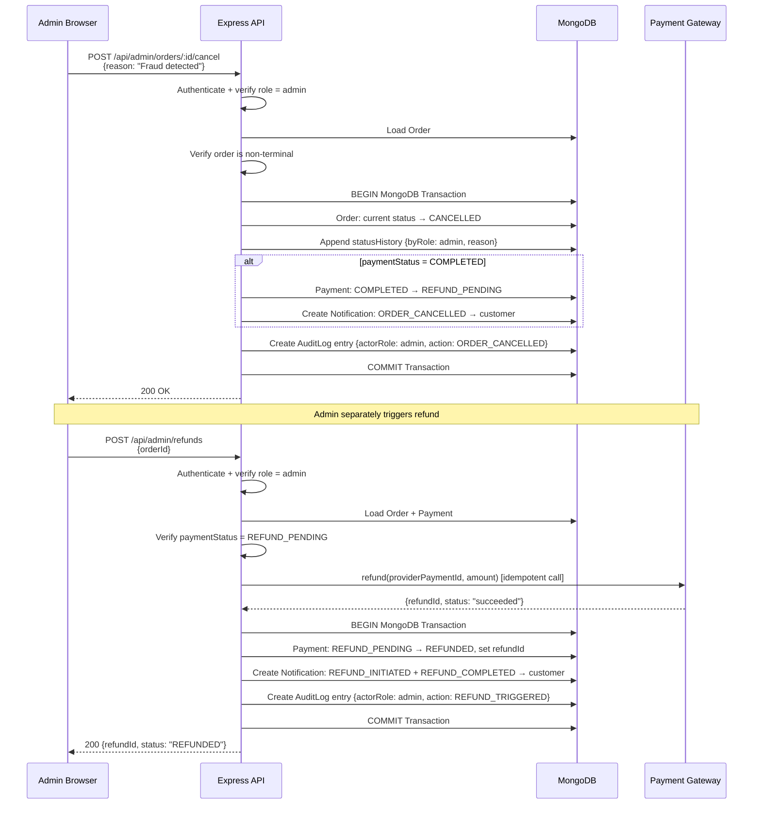
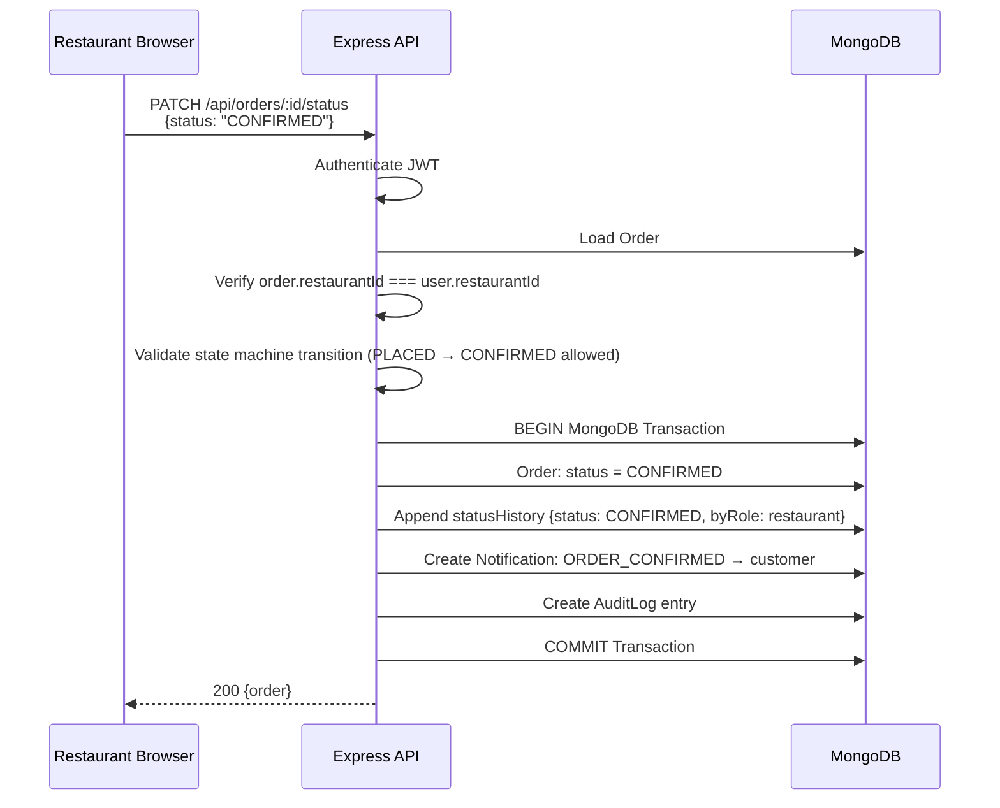

# 29 — Data Flow & Sequence Specification

## 1. Security Boundary Reminder

The client is an **untrusted boundary**. The server never accepts client claims about:
- User role, account status, or ownership
- Item prices or order totals
- Payment success, payment status
- Order status or cart contents
- Discount amounts or promotional values

---

## 2. Checkout Quote Flow

---

## 3. Online Payment Checkout & Webhook Flow `[D11]` `[D24]` `[D25]`

---

## 4. Unpaid Order 15-Minute Expiry Job `[D24]`

---

## 5. Admin Order Cancellation & Full Refund Flow `[D13]` `[D14]` `[D16]`

---

## 6. Restaurant Status Advancement Flow

---

## 7. Failure Principle

If any external service (payment gateway, file storage) fails, the server must:
1. Preserve a consistent internal state (do not partially commit).
2. Return an appropriate error code to the client.
3. Allow safe retry without creating duplicate financial records or orders.
4. Never swallow errors silently — log with request ID (no PII in logs).
